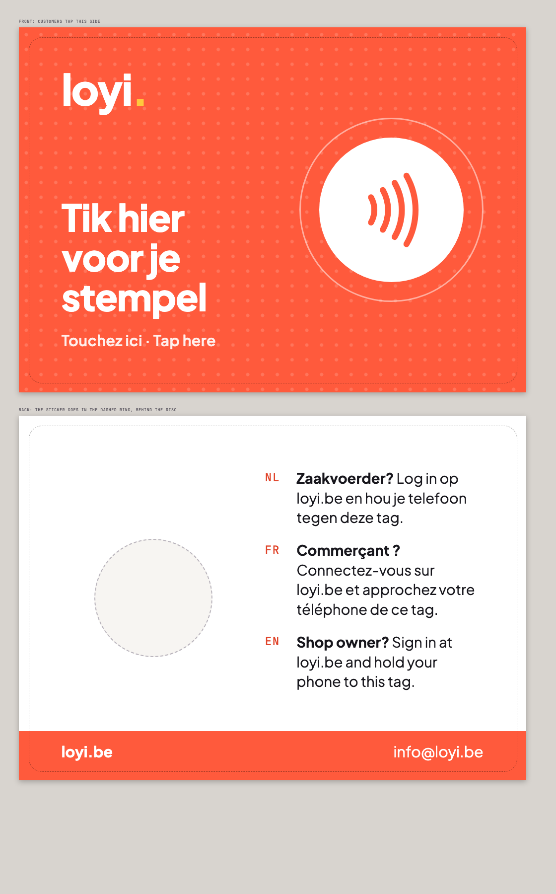

# The Loyi tag card

The card a pilot shop gets: a big, thick **PVC card, A6 landscape (148.5 × 105 mm)**, four of them fill one A4, with
**one secure NTAG 424 DNA sticker on the back**. Customers tap the front, the sticker behind the PVC does the rest.
Same card for every shop: nothing on it names the shop.

| File | Use |
| --- | --- |
| `loyi-tag-card-shop.pdf` | For a card printer: 2 pages (front, back), 154.5 × 111 mm = 148.5 × 105 mm card + 3 mm bleed |
| `loyi-tag-card-a4-4up.pdf` | 2 A4 landscape pages (fronts, backs), 4 cards each, edge to edge: for a printer that prints and cuts A4 sheets |
| `loyi-tag-card.html` | The design (edit texts, sizes and colours here); `./build.sh` rebuilds the PDFs and the preview |

## Order the cards

- **Size:** A6 landscape, 148.5 × 105 mm. Corners straight or rounded (4 mm radius looks right; a die-cut costs extra at some printers).
- **Thickness:** the artwork doesn't set it, you tell the printer. **1.5–2 mm** white PVC feels solid. Stay under about 3 mm and
  don't put the sticker inside layers thicker than that: a 25 mm NTAG 424 reads through 2 mm of PVC, but **test one first**.
- **Print:** double-sided full colour, glossy or matte. The front is all coral, so ask for edge-to-edge printing.
- **No metallic foil, gold/silver ink or metal-effect PVC**: they block NFC. Plain colour is fine.
- **Blank, no chip:** the sticker is the chip. A printer can also glue the sticker on if you send it programmed.
- **Which file:** a card printer wants `loyi-tag-card-shop.pdf` (their own template wins on bleed). The A4 sheet is for a
  printer who prints PVC or card on A4 and cuts it into quarters along the centre lines. It has no bleed inside the sheet.
- **A4 sheet, double-sided:** flip on the **short edge** (like turning a book page). Check that the dashed ring on the back
  sits behind the white disc on the front before you print a batch.
- Order **1 test card first**.

## Put the tag on

1. Program and check the sticker first (docs/KIT.md §3).
2. Peel it and press it flat in the **dashed ring on the back**: the ring is 36 mm wide, so a 25 or 29 mm sticker fits.
3. Optional: cover it with a clear round label so the edge doesn't catch. Tap the front with a phone: it must open Loyi.
4. The card works on a counter, not on bare metal (a metal till or tray stops NFC): stand it in an acrylic holder or put it
   on a piece of wood or plastic.

The front says **Tik hier voor je stempel** (Touchez ici · Tap here); the back has one line for the shop owner in nl/fr/en.
The steps for the shop are on the A6 instruction card (`../instructions.html`) that goes with it.
